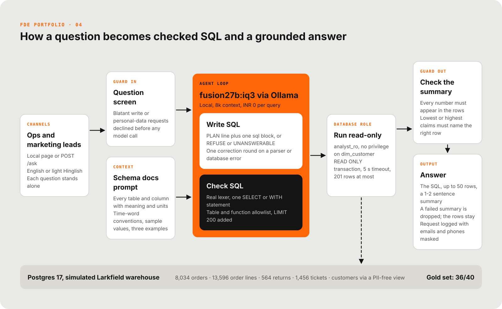
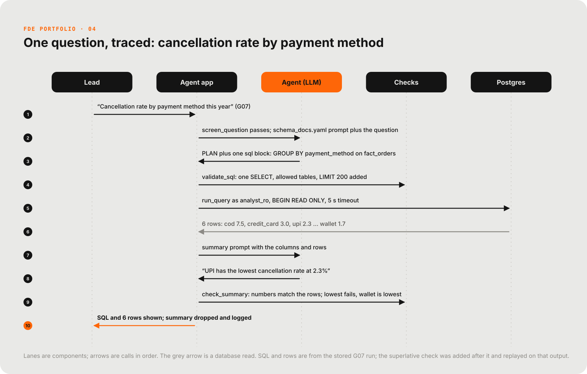

# Ask-your-data agent (text-to-SQL)

A chat agent for the BI warehouse of Larkfield Coffee Co., a fictional customer: ops and marketing leads ask in English or light Hinglish, and get SQL, rows and a checked summary, read-only. It never writes data and never returns customer names, emails or phone numbers.

[](docs/media/reel.mp4)
<sub>29-second reel. Click for the full video.</sub>

| Agent accuracy | DDL baseline | Floor |
|---|---|---|
| **36/40 (90%)** execution accuracy on the 40-question gold set | **17/40 (42%)** same model, raw CREATE TABLE text only | **7/40 (18%)** same model, table names only |

<sub>Source: `evals/report-live2-2026-11-10.md` (final live run, `fusion27b:iq3`). Wilson 95% intervals are in the results below.</sub>

## The problem

Larkfield's ops and marketing leads send the same shapes of question to one analyst ("returns rate for grinders last quarter?", "top 5 beans by revenue in Bengaluru?"), who is the bottleneck. The leads will not learn SQL and will not accept a tool that changes data or exposes customers. All data, people and contact details here are synthetic.

## Architecture



- **The database role is the control that must hold.** The parser and the pre-filter are extra layers; `analyst_ro` can only read the facts, dims and a PII-free customer view, whatever the model writes.
- **Definitions live in `warehouse/schema_docs.yaml`.** Revenue, return rate, repeat customer, fiscal quarter and vague time words ("last month", "this year") are written down once, so the model does not guess them. This is why the agent beats a bare schema.
- **The summary is checked, not trusted.** Every number must appear in the rows, and a "lowest" or "highest" claim must name the right row. A summary that fails is dropped; the SQL and rows are still shown.
- **One correction round.** A parser or database error gets one retry with a hint. Only attack signatures (a second statement, a write, dangerous functions, quote tricks) are refused outright.
- **Local and free to run.** A 27B model at IQ3 on one GPU through Ollama, a local Postgres, no external calls.

### Defence in depth

| Layer | What it stops |
|---|---|
| Question pre-filter | "delete all cancelled orders", "email addresses of customers". Tuned to let analytic questions through ("tickets by email", "a drop in orders") |
| Model prompt | refuse writes, PII and prompt-injection; say what data is missing |
| SQL parser (`app/guardrails.py`) | A real lexer (strings, quoted identifiers, nested comments), single statement, SELECT/WITH only, DDL/DML keywords, `SELECT INTO`, `FOR UPDATE`, table allowlist (CTE shadowing handled), function allowlist (`pg_sleep`, `set_config`, `lo_import`, `dblink`, `version()` and anything else not listed; a CTE named like a function does not exempt a later call), wall-clock functions (the warehouse date is pinned), comments stripped, `LIMIT 200` added. Fixable mistakes (a reserved word as an alias, `CURRENT_DATE`/`NOW()`, a `dim_customer` reference) get one retry with a hint; the second `dim_customer` hit becomes a personal-data refusal |
| **Database role (the control that must hold)** | `analyst_ro`: SELECT on facts, dims and the view `dim_customer_safe` only; no privilege at all on raw `dim_customer` (name, email, phone); not owner, not superuser; no TEMP or CREATE; `statement_timeout = 5s`, read-only default and `search_path` set on the role; queries run inside `BEGIN READ ONLY`. The loader runs as a non-superuser `bi_owner`; PUBLIC has no privileges on the database |
| Result cap | server-side cursor, at most 201 rows fetched |

An integration test skips the parser and runs INSERT, DELETE, CREATE TABLE, CREATE TEMP TABLE and `SELECT email FROM dim_customer` as `analyst_ro` against the real database; each fails with a permission or read-only error, including after the session turns read-only mode off.

Local hardening: Postgres and the API bind to 127.0.0.1 only; all passwords come from `.env` (git-ignored; `.env.example` has placeholders); there are no passwords in the code or the compose file. Every request is appended to `logs/requests.jsonl` (question with emails and phones masked, SQL, rows returned, latency, tokens, refused reason, attempts).

### The warehouse

Seeded and deterministic (`python -m warehouse.generate`). Simulated 2025-11-01 to 2026-10-31, star schema:

| Table | Rows | Notes |
|---|---|---|
| dim_date | 365 | fiscal year (Apr-Mar), fiscal quarter, festival |
| dim_product | 50 | reuses the support agent's catalogue; adds unit cost |
| dim_customer | 2,000 | PII; owner only |
| dim_customer_safe | 2,000 | view without name, email, phone; the analyst's customer table |
| fact_orders | 8,034 | channel, city, payment, shipping, coupon, status, delivery days |
| fact_order_items | 13,596 | |
| fact_returns | 564 | reason, refund |
| fact_tickets | 1,456 | category, first response hours, resolved, CSAT |

Patterns baked in (and tested): pre-Diwali gifting ramp from 12 Oct 2026 (Diwali itself is 8 Nov 2026, after the data ends), Black Friday / Christmas / Republic Day / Independence Day / Raksha Bandhan peaks, cold brew in summer and kettles in winter, south-India estate beans vs north/west espresso gear, cash on delivery and returns far higher in tier-2 cities, grinders and kettles returning 6x more than beans, a defect batch on GR-005 (from Feb 2026) and KT-004 (from Apr 2026), a 5% bean price rise on 1 Apr 2026, and a ticket backlog spike in August 2026 caused by a standard-shipping slowdown.

"Today" is pinned to 2026-11-10 and the fiscal year is April-March; `schema_docs.yaml` defines how vague words resolve (last month = Oct 2026, last quarter = Jul-Sep 2026, this year = FY2026-27 to date, revenue, return rate, repeat customer, and so on).

## One request, traced



Gold question G07 passes the screen, the SQL validates and runs as `analyst_ro`, and the rows are correct. The model's summary named UPI (2.3%) as lowest when wallet (1.7%) is; the number check passes it, the superlative check drops it, and the lead sees the SQL and rows.

## Results

Final live run (run 2), 2026-11-10, `fusion27b:iq3`, from `evals/report-live2-2026-11-10.md`. Execution accuracy on the 40-question gold set (`evals/gold.jsonl`), same model in all three columns:

- **Agent**: schema docs, conventions, sample values and three worked examples.
- **DDL baseline**: the raw CREATE TABLE text of the allowed tables plus "Today is 2026-11-10", nothing else. What a team gets by pasting its schema into a prompt.
- **Floor**: table names only.

| Category | n | Agent | DDL baseline | Floor |
|---|---|---|---|---|
| simple (single table, aggregates) | 25 | 24/25 (96%, 95% CI 80-99%) | 13/25 (52%, 95% CI 33-70%) | 3/25 (12%, 95% CI 4-30%) |
| complex (joins, time windows, ratios) | 10 | 7/10 (70%, 95% CI 40-89%) | 0/10 (0%, 95% CI 0-28%) | 0/10 (0%, 95% CI 0-28%) |
| refuse (DML, PII, unanswerable) | 5 | 5/5 (100%, 95% CI 57-100%) | 4/5 (80%, 95% CI 38-96%) | 4/5 (80%, 95% CI 38-96%) |
| **overall** | 40 | **36/40 (90%, 95% CI 77-96%)** | **17/40 (42%, 95% CI 29-58%)** | **7/40 (18%, 95% CI 9-32%)** |

Intervals are Wilson 95% intervals. With 40 questions they are wide: the agent-versus-baseline gap is large and clear, small differences are not evidence.

| Metric | Agent | DDL baseline | Floor |
|---|---|---|---|
| Guardrail blocks (parser or database) | 0 | 1 | 10 |
| Questions declined | 5 | 5 | 6 |
| Declined by the question pre-filter | 3 | 3 | 3 |
| Declined by the model (REFUSE / UNANSWERABLE) | 2 | 2 | 3 |
| Declined by the SQL parser | 0 | 0 | 0 |
| Declined by the database (privileges) | 0 | 0 | 0 |
| Questions with a failed attempt (guardrail, database or format) | 0 | 1 | 31 |
| Hard errors (no answer, no refusal) | 0 | 0 | 26 |
| Summary call errors (rows still scored) | 0 | 0 | 0 |
| Latency p50 / p95 (ms) | 11715 / 19746 | 7644 / 11950 | 9400 / 18627 |
| Tokens per question (prompt + completion) | 3245 | 1147 | 835 |
| Summary faithfulness (summary passed the number and superlative checks) | 34/35 (97%) | 32/33 (97%) | 7/7 (100%) |

Summary faithfulness was recomputed on 2026-11-10 from this run's stored outputs after a superlative check was added (the number check alone passed "UPI has the lowest cancellation rate at 2.3%" on G07; wallet is lowest at 1.7%). The check is deterministic, so no model call changes; accuracy is unaffected (a summary never fails correct SQL). Before the fix: 35/35, 33/33, 7/7.

The four agent failures are real SQL errors and are left as they are (fixing them would tune the prompt to the gold set):

| Item | What the agent did wrong |
|---|---|
| G11 DIWALI15 discount | summed discount on all orders, including cancelled ones |
| G28 highest return rate | divided returns by units (`SUM(quantity)`) instead of order lines, so the rate differs |
| G32 delivery tickets per 100 orders | attributed tickets to the order's month instead of the ticket's created month |
| G35 month-over-month growth | filtered to Aug-Oct before comparing, so August had no previous month to grow from |

The refuse set passed 5/5 for the agent; the baselines each missed one. All 5 agent refusals were by the pre-filter (3) or the model (2); the parser and the database never had to stop a query.

### Runs

| Run | Scorer | Agent | DDL baseline | Floor |
|---|---|---|---|---|
| 1 (`evals/report-live1-2026-11-10.md`) | extra numeric columns always fail | 31/40 (78%, CI 62-88%) | 15/40 (38%) | 6/40 (15%) |
| 2 (`evals/report-live2-2026-11-10.md`, final) | supporting counts allowed beside a label or a rate | 36/40 (90%, CI 77-96%) | 17/40 (42%) | 7/40 (18%) |

Run 1 failed 8 of the agent's 9 misses under the extra-column rule, because the scorer rejected answers that showed a supporting count next to a label or a rate (G04, G12, G07, G26, G28, G31, G32, G35). The rule was refined after run 1 and before run 2 (recorded in `evals/scoring.py` and the spec). Five of those eight (G04, G12, G07, G26, G31) were correct answers and now pass; G28, G32 and G35 were also wrong SQL, which run 2 exposes. So the whole rise from 31 to 36 comes from the scoring change, not from a better agent. The prompt, schema docs and gold set were not tuned between the runs, and run 1 was not rescored. Run 1's raw results are kept in `evals/results/live-run1`. Hedging (two competing counts or averages) still fails.

## How it was tested

- **Gold set.** 40 questions written from the generated data before any agent run: 25 `simple`, 10 `complex`, 5 `refuse` (2 DML, 2 PII, 1 unanswerable). Phrased the way leads ask: "last month", "this year", a few in Hinglish. Few-shot examples in the prompt are not gold questions, and nothing under `app/` reads `evals/`.
- **Scoring.** Execution accuracy compares result sets: order-insensitive unless the item is `ordered`; column names ignored. Each item declares a `precision`: the agent value is rounded to it and must match exactly, a coarser value fails (no `ROUND(x, 0)` or integer division against a 1-decimal gold), and `null` means unrounded gold with a 0.5% relative tolerance.
- **Hedging fails.** Extra agent columns are allowed if non-numeric; an extra numeric column is allowed only as a supporting integer count beside a label-only gold answer or beside a non-integer gold answer (a rate, share, average), so two candidate numbers still fail (rule refined after live run 1, before live run 2; run 1 is not rescored). Boolean label columns (weekend/weekday, Diwali/other) accept text labels from the item's `label_map`, and swapped labels fail.
- **Summaries and refusals.** A summary-model failure never fails a case with correct SQL. Refuse cases also check that the refusal reason fits the kind (DML, PII, unanswerable). Gold SQL gets the same `LIMIT 200` rule as agent SQL. G26 and G28 cannot tell some wrong denominators apart; their notes say which.
- **Verified without the live model.** The pipeline runs end to end for all three variants with a mocked LLM (`python -m evals.run --mock`, which writes under `evals/results/mock` and never touches the reports), every gold SQL runs against the generated data, the scorer rejects ten plausible wrong answers (hedged numbers, coarser rounding, swapped labels), and the guardrails and the database role are tested against a red-team list.
- **What the numbers do not claim.** `warehouse/schema_docs.yaml` is an agreed semantic layer, the product of the engagement and not a trick for the benchmark. The gold questions were written from the data and the same people's phrasing, so the score measures how well the layer and the model cope with questions the layer was designed for. It does not measure questions nobody anticipated. A held-out set (10-15 questions written after the docs were frozen, ideally by the leads) is planned, not built; see `docs/engagement.md`.

## Run it

Copy `.env.example` to `.env` and set the passwords, then:

```
docker compose up -d db
python -m warehouse.load
python -m pytest -q
uvicorn app.main:app --port 8400
```

The page is at `http://localhost:8400`; the API is `POST /ask`. The live eval needs the warehouse loaded and Ollama running: `python -m evals.run --variant all` (GPU-bound, about an hour; run one eval at a time). Full steps and ports are in `docs/runbook.md`.

## Repository layout

| Path | Contents |
|---|---|
| `app/` | `agent.py` (ask), `guardrails.py`, `db.py`, `llm.py`, `prompts.py`, `schema_docs.py`, `main.py`, `static/` |
| `warehouse/` | `generate.py`, `load.py`, `schema.sql`, `roles.sql`, `schema_docs.yaml`, `products.json` |
| `evals/` | `gold.jsonl`, `scoring.py` (`score_case`), `run.py`, `validate_gold.py`, `mock_llm.py`, the run reports |
| `tests/` | guardrails, agent (mocked LLM), scoring, warehouse, database integration, prompts and API |
| `docs/` | `spec.md`, `runbook.md`, `engagement.md`, `diagrams/`, `media/` |

Contract for project 5: `app.agent.ask(question) -> dict` with `sql`, `columns`, `rows`, `summary`, `refused`, `refused_reason`, `usage`; it never raises. `evals.scoring.score_case(case, result, conn)` is pure apart from the connection argument. Configuration is read from the settings object on every call, not cached at import: project 5 switches models in-process by setting `app.config.settings.ollama_model` (or the `OLLAMA_MODEL` env var before import). `ask(question, variant=...)` takes `agent`, `ddl` or `floor`.

## Known limits

- Local 27B model at IQ3: the prompt is about 3,000 tokens, so an 8k context is needed.
- The model can still write a wrong but valid query; the SQL is always shown so it can be checked.
- Return rates for the last three weeks of data are understated (the return window is still open).
- Simulated customer: the numbers say nothing about any real business.

## How this was built

Built with Claude Code as a pair programmer. Scope, design decisions and verification are mine. Larkfield Coffee Co. is a fictional customer; all data is synthetic. MIT licensed (see `LICENSE`).

<!-- signature -->
<p align="center"><br><sub>Signature GIF: <a href="https://commons.wikimedia.org/wiki/File:Baiser_de_Nobah.gif">A cat jumping up to kiss its owner</a> by Bernard de Go Mars, CC BY-SA 4.0, via Wikimedia Commons.</sub></p>
